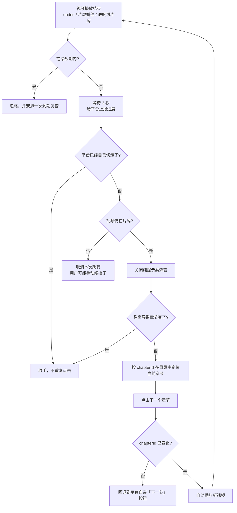

<div align="center">

# 🎬 HUST SmartCourse 自动连播

**华中科技大学「智慧课程 / 超星」视频播完，自动切到下一节**

[](https://github.com/Charlotte5622/hust-smartcourse)
[](https://github.com/Charlotte5622/hust-smartcourse/releases/latest)
[](LICENSE)
[](https://www.tampermonkey.net/)
[](https://violentmonkey.github.io/)
[](https://www.mozilla.org/firefox/)
[](https://www.google.com/chrome/)

一节播完自动点下一节，**挂着就行，不用守着。**

[安装](#-安装) · [使用](#-使用) · [配置](#-配置项) · [原理](#-工作原理) · [常见问题](#-常见问题)

</div>

---

## 📖 这是什么

`smartcourse.hust.edu.cn` 上的课程视频，播完只会停在最后一帧，要手动去右边「目录」里点下一节。这个脚本接管了这件事：

> 检测到视频播放结束 → 等 3 秒让平台上报进度 → 在目录里点下一节 → 自动播放 → 循环往复

它**不修改任何请求、不伪造播放进度**，只是在正确的时机替你点了一下目录。每节的观看时长仍然由平台自己统计，你该看多久还是得看多久。

> **它做什么**：导航自动化 —— 检测视频结束、找到下一节、点进去、开始播放。
> **它不做什么**：答题、填答案、自动提交测验。<u>脚本会跳过章节测验并记录下来，让你自己回头做。</u>

## ✨ 特性

| | 特性 | 说明 |
|---|---|---|
| 🔁 | **顺序连播** | 默认严格按目录顺序推进，一节都不跳 |
| 🧭 | **跨 iframe 找目录** | 新版「智慧课程」的目录面板本身在 iframe 里，脚本会递归扫描所有同源文档 |
| 🎯 | **精确自我定位** | 用 URL 里的 `chapterId` 匹配目录节点，不依赖会变的 CSS 类名 |
| ⏭️ | **自动跳过测验** | 遇到章节测验/作业等非视频任务点自动略过并记录，不影响连播节奏 |
| 🛡️ | **不猜、不代答** | 认不出类型的任务点会停下来等你确认；**永远不会替你答题或提交** |
| 🔒 | **防多跳** | 冷却期 + 切换前复查 + 只点"关闭"类弹窗，不会一次跳两节 |
| ⏯️ | **自动播放** | 切过去自动点播放，被浏览器拦截时可选择静音重试 |
| 🎛️ | **可视化面板** | 右下角面板：实时状态、跳转计数、已跳过测验清单，可拖动、可折叠 |
| 🧭 | **手动导航按钮** | 面板上直接点「上一节 / 下一节 / 下一个未完成」，不用等视频播完 |
| 🔇 | **屏蔽平台报错** | 顺手消掉超星播放器自身的 `picUrl` 报错噪音 |
| 🐞 | **可调试** | 控制台 `__autoNext.info()` 一键查看脚本当前"认为"你在哪一节 |

## 📦 安装

### 1. 装一个用户脚本管理器

| 浏览器 | 推荐 |
|---|---|
| Firefox / Chrome / Edge | [Tampermonkey（篡改猴）](https://www.tampermonkey.net/) |
| 任意 Chromium 系 | [Violentmonkey（暴力猴）](https://violentmonkey.github.io/) |

> ⚠️ **不要用 Greasemonkey 4**，它对 iframe 的脚本注入支持不完整，本脚本会抓不到视频。

### 2. 装脚本

**方式 A：从文件导入（推荐，火狐必须这样）**

1. 下载 **[最新 Release](https://github.com/Charlotte5622/hust-smartcourse/releases/latest)** 里的 `hust-smartcourse-auto-next.user.js`
   （或直接点这个固定链接：[`releases/latest/download/hust-smartcourse-auto-next.user.js`](https://github.com/Charlotte5622/hust-smartcourse/releases/latest/download/hust-smartcourse-auto-next.user.js)）
2. 打开 Tampermonkey 面板 → **实用工具 / Utilities**
3. 「导入」区域 → 选择文件 → 选中刚下载的 `.user.js`
4. 弹出安装页 → 点 **安装**

> Firefox 直接双击本地 `.user.js` 只会当文本打开、不会触发安装，因为 Tampermonkey 的 URL 拦截对 `file://` 不生效。用上面的导入方式即可。

**方式 B：新建脚本粘贴**

Tampermonkey 面板 → `+` 新建 → 删掉模板 → 粘贴脚本全文 → `Ctrl + S`

装好后浏览器工具栏的猴子图标上会出现一个 `1`，点开能看到脚本已启用。

### 3. 验证

打开课程页面，按 `F12` 打开控制台，应该能看到：

```
[自动连播] 顶层脚本已启动
[自动连播] 已绑定视频元素 <video id="video_html5_api" ...>
[自动连播] 目录面板所在文档：https://smartcourse.hust.edu.cn/mooc-smartcourse/mycourse/studentstudy?...
[自动连播] 采集到章节节点数：155
```

页面右下角同时会出现深色的 **🎬 自动连播** 面板。这两样都有了，就成了。

## 🚀 使用

装好之后不需要任何操作，正常上课即可：

1. 随便点开一节视频，让它正常播放；
2. 播到结尾后等大约 3 秒，脚本会自动切到下一节并开始播放。

### 右下角控制面板

```
┌──────────────────────────────┐
│ 🎬 自动连播  ●           [—] │  ← 标题栏可拖动，[—] 折叠成小条
│ 播放中：3.3 职业兴趣，你喜欢… │  ← 实时状态，完整换行不截断
│ 跳转 3 次 · 跳过测验 1 个     │  ← 本次统计，不会被按钮挤掉
│ 已跳过：3.10 如何打造核心竞争力│
│ [⏮ 上一节]  [⏭ 下一节]       │  ← 手动导航，立即执行
│ [⏩ 下一个未完成] [⏸ 暂停]     │
└──────────────────────────────┘
```

| 按钮 | 作用 |
|---|---|
| **⏮ 上一节** | 立刻回到目录里的上一节 |
| **⏭ 下一节** | 立刻跳到下一节（不用等视频播完） |
| **⏩ 下一个未完成** | 从当前位置往后找第一个**没有绿勾**的节点并跳过去 |
| **⏸ 暂停 / ▶ 启用** | 总开关 |

面板**可以用标题栏拖动**，挡住视频就拖走；点右上角 `[—]` 可以折叠成一条小标题，不占地方。

## ⚙️ 配置项

脚本开头的 `CFG` 对象就是全部开关，改完保存、刷新页面即生效：

```js
const CFG = {
  delayBeforeNext : 3000,   // 视频结束后等多久(ms)再切换
  switchCooldown  : 8000,   // 两次自动切换的最小间隔(ms)
  skipCompleted   : false,  // false=顺序播放；true=跳过已完成的章节
  skipNonVideo    : true,   // 自动跳过章节测验/作业等非视频任务点
  nonVideoWaitMs  : 6000,   // 判断任务点类型的等待上限
  contentSettleMs : 1500,   // 点击后等 iframe 换完内容再判断
  maxHopsPerStep  : 10,     // 一次连播最多连续跳过几个非视频节点
  autoPlay        : true,   // 切换后自动点播放
  muteIfBlocked   : false,  // 自动播放被拦截时，静音重试
  clickPopups     : true,   // 自动关掉"继续观看"类弹窗
  silencePlayerBug: true,   // 屏蔽超星播放器的 picUrl 报错
  pollInterval    : 1500,   // 扫描 <video> 的间隔(ms)
  debug           : true,   // 控制台日志
};
```

| 配置 | 什么时候改 |
|---|---|
| `delayBeforeNext` | 发现"任务点未记录完成"→ 调大到 `5000`，给平台更多上报时间 |
| `switchCooldown` | 偶尔还会连跳 → 调大到 `15000` |
| `skipCompleted` | 想连已完成的章节一起重刷 → 保持 `false`；想跳过绿勾章节 → 改 `true` |
| `skipNonVideo` | 想连章节测验也一起停下来自己做 → 改 `false` |
| `maxHopsPerStep` | 连续跳过的测验太多想中途停一下 → 调小到 `3` |
| `muteIfBlocked` | 切过去后停在暂停状态 → 改 `true`（代价是静音播放） |
| `clickPopups` | 担心误点弹窗 → 改 `false` |
| `debug` | 平时嫌日志吵 → 改 `false` |

## 🔍 工作原理



几个关键设计：

- **视频在 iframe 里，目录也在 iframe 里。** 脚本以 `@grant none` 注入所有匹配的帧：视频帧负责监听 `<video>`，顶层帧负责操作目录，跨域时用 `postMessage` 上报。同一域名时顶层还会递归钻进 iframe 直接绑定，双保险。
- **用 `chapterId` 而不是 CSS 选择器定位当前章节。** 超星各校部署的类名差异很大，但 URL 里的 `chapterId` 是稳定的。
- **三重"片尾"判定。** 标准 `ended` 事件 + `timeupdate` 剩余时长 + `pause` 时剩余时长，覆盖那些不派发 `ended` 的播放器。
- **只点"关闭"性质的弹窗。** 白名单里**故意不包含**「下一节/下一章」——平台自己有这个按钮，点了它会跳一次、目录再跳一次，就是一次跳两节。

## 🛠 调试

脚本在 `window` 上挂了一个调试入口，控制台直接用：

```js
__autoNext.info()     // 我在哪一节、下一节是哪节、视频状态
__autoNext.list()     // 完整目录顺序
__autoNext.states()   // 每一节的完成状态判定
__autoNext.next()     // 立刻执行一次跳转
__autoNext.prev()     // 跳到上一节
__autoNext.incomplete() // 跳到下一个未完成的节点
__autoNext.ended()    // 模拟"视频播完"的完整流程
__autoNext.detect()   // 判断当前章节是 video / quiz / unknown
__autoNext.skipped()  // 本次自动跳过了哪些测验
__autoNext.off()      // 暂停
__autoNext.on()       // 启用
```

`info()` 的输出长这样：

```js
{
  chapters: 155,
  currentIndex: 4,
  currentTitle: "1.5 人人都是心理学家",
  nextTitle: "1.6 心理咨询，你别误会",
  videos: [{ t: 132.9, d: 353.8, paused: false, ended: false }],
  ...
}
```

**只要 `currentTitle` 和 `nextTitle` 是连着的，就说明定位正确。**

## ❓ 常见问题

<details>
<summary><b>右下角没有面板，控制台也没有 <code>[自动连播]</code> 日志</b></summary>

脚本没跑起来，按顺序排查：

1. Tampermonkey 面板里脚本是**启用**状态吗？图标上有数字 `1` 吗？
2. 装完之后**刷新页面**了吗？脚本只在页面加载时注入。
3. 地址栏的域名是 `smartcourse.hust.edu.cn` 吗？如果是别的域名，在脚本头部加一行 `// @match *://新域名/*`。
4. 控制台过滤框里是不是输了东西？清空试试。
5. Firefox：控制台默认只显示当前文档的日志，脚本在 iframe 里打的日志需要切换上下文才能看到。
</details>

<details>
<summary><b>播完了但一动不动</b></summary>

看控制台最后几行：

- 停在 `目录面板所在文档` 之前 → 目录没被识别，跑 `__autoNext.list()` 看返回啥。
- 显示 `冷却中（还需 N 秒）` → 正常，等等就好。
- 显示 `没找到下一个任务点` → 已经学到最后一节了。
- 显示 `视频已不在片尾` → 那 3 秒里视频被续播了，属于正常保护。
- 什么都没有 → 视频可能根本没触发结束事件，看 `__autoNext.info()` 里 `videos` 的 `t` 和 `d`。
</details>

<details>
<summary><b>课程里有章节测验，脚本会怎么处理？</b></summary>

**会跳过，但不会替你答。**

流程是：点进一个章节 → 等 iframe 换完内容 → 判断里面是视频还是测验。

- 识别为**视频** → 正常监听播放，播完继续
- 识别为**测验/作业** → 记下来、继续往后找视频（日志会打印 `是测验/作业类任务点 → 已跳过（不代答，请自行补做）`）
- **认不出来** → 停下并在面板提示，不猜、不硬跳

被跳过的测验会累积在 `__autoNext.skipped()` 里，方便你回头补做。只想跳过一次几个，把 `maxHopsPerStep` 调小即可。

> ⚠️ 本脚本**不包含也不会包含**任何答题、填答案、自动提交的功能。测验请自己做。
</details>

<details>
<summary><b>一次跳了两节甚至更多</b></summary>

v1.5.0 已修。如果还在发生：

1. 先看是不是 `skipCompleted: true` 跳过了绿勾章节 —— 那是设计行为，改成 `false` 即可；
2. 日志里如果出现 `平台已自动切换章节，跳过本次操作`，说明是**超星自己在跳**，不是脚本；
3. 还不行就把 `switchCooldown` 调到 `15000`。
</details>

<details>
<summary><b>控制台一直报 <code>thumbnailsArray[...].picUrl is undefined</code></b></summary>

**这是超星播放器自己的 bug，与本脚本无关。** 看错误堆栈，从第一帧到最后一帧全是 `ananas/modules/video/index.js` 和 `ext-4.2.0.663/all-classes.js`，没有一行是本脚本。

成因：播放器初始化时按序号去 `thumbnailsArray[i]` 取进度条预览图，该课件的缩略图元数据数组长度不够，索引越界。**只影响进度条悬停预览，不影响播放和进度统计。**

`silencePlayerBug: true`（默认）会把它从控制台滤掉，但注意：这个屏蔽只在 **Firefox** 生效（Chrome 不认 `ErrorEvent.preventDefault()`）。
</details>

<details>
<summary><b>切过去之后停在暂停状态</b></summary>

浏览器拦截了自动播放（没有用户交互的标签页不允许自动出声）。两种办法：

- 把 `muteIfBlocked` 改成 `true`，脚本会静音后重试；
- 或者不管它，手动点一下播放键，脚本检测到 `playing` 后会继续正常工作。
</details>

<details>
<summary><b>进度条拖不动 / 进度没被记录</b></summary>

这是平台限制，不是脚本问题。超星的任务点判定规则是**「观看时长 ≥ 总时长的 90%」**，未完成的任务点不允许拖动进度条。脚本只负责切下一节，**每节仍然要真实播够时长**才会记为完成。

所以挂机时：别关标签页、别让系统休眠、别用浏览器的"标签页休眠"功能——视频暂停了就不会触发切换。
</details>

<details>
<summary><b>Firefox 控制台粘贴多行代码报 <code>allow pasting</code></b></summary>

Firefox 的防诈骗保护。在控制台里手动敲 `allow pasting` 回车，之后就能正常粘贴了。
</details>

## 📋 兼容性

| 项目 | 状态 |
|---|---|
| 站点 | `smartcourse.hust.edu.cn`（已实测）<br/>其他超星/学习通部署（`*.chaoxing.com`、`*.chaoxing.cn`）已加匹配，理论可用但未实测 |
| 浏览器 | Firefox ✅（主要开发环境）· Chrome / Edge ✅ |
| 管理器 | Tampermonkey ✅ · Violentmonkey ✅ · Greasemonkey 4 ❌ |
| 课程 | 已实测「研究生心理健康」课程，其他课程如遇目录结构不同请开 issue |

## 📝 更新日志

| 版本 | 内容 |
|---|---|
| **1.8.0** | **控制面板重做**：新增「上一节 / 下一节 / 下一个未完成」手动导航按钮；状态与统计分行显示不再被挤掉；面板可拖动、可折叠 |
| 1.7.1 | 章节标题不再混入"未完成任务点"计数角标 |
| 1.7.0 | **新增自动跳过章节测验/作业**：点击后识别任务点类型，是测验就略过继续往后找视频；认不出类型则停下等你确认。新增 `detect` / `skipped` 调试命令 |
| 1.6.0 | **默认改为顺序播放**（`skipCompleted: false`）；修复"部分完成的章节被误判为已完成而跳过"；修复循环中反复读取 `chapterId` 导致定位飘移；定位失败时不再从课程第一节开始 |
| 1.5.0 | 修复一次跳两节：弹窗白名单移除「下一节/下一章」、点完弹窗复查 URL、切换前复查视频是否仍在片尾、冷却期改为到期复查 |
| 1.4.0 | 新增 `silencePlayerBug`，屏蔽超星播放器自身的 `picUrl` 报错 |
| 1.3.0 | 排除 `<link href=".../studentStudy.css">` 被误认成章节；点击后校验跳转是否成功 |
| 1.2.0 | **修复目录在 iframe 中导致完全无法识别**（即"没反应"的根因） |
| 1.1.0 | 初版 |

## ⚠️ 免责声明

- 本项目仅供**个人学习与自动化便利**使用，请勿用于刷课、代看等违反学校规定的用途。
- 脚本只做「检测播放结束 + 点击下一节」这一件事，**不修改、不伪造、不绕过**平台的任何学习时长统计。
- 脚本**不含任何答题功能**，遇到章节测验会自动跳过并记录，请自行完成。
- 使用本脚本产生的任何后果由使用者自行承担，与作者无关。

## 📄 License

[MIT](LICENSE) © Charlotte5622

<div align="center">

**如果这个脚本帮你省下了守着点「下一节」的时间，点个 ⭐ 吧**

</div>
